# Lab 3: REST API Query Parameters, Validation, and Debugging

**Subject:** Backend Development Fundamentals  
**Year/Term:** Year II, Term II  
**University:** Aurora Deemed to be University  
**Faculty:** Mr. Joel Prashanth D

## Student Details

| Field | Details |
|---|---|
| Name | K.Bhargava Sai |
| Registration Number | 252U1R9055 |
| Section | CSE - GEN-AI - 2A-304 |

## Live Demo

**Live URL:** To be added after deployment  
**Local Server:** `http://localhost:3000`  
**GitHub Repository:** [Backend Development Fundamentals](https://github.com/kbhargavasai2468-cyber/Backend-Development-Fundamentals)

**Note:** The API was tested locally using the Postman Desktop Application. The public deployment URL will be added after deployment and GitHub push.

---

## 1. Objective

To enhance the REST API from Lab 2 by implementing query parameters for searching, sorting, pagination, and price filtering, along with request validation and appropriate error handling.

## 2. Technologies Used

- Node.js — JavaScript runtime environment
- Express.js — Backend web framework
- SQLite — Relational database
- sqlite3 — SQLite database driver
- sqlite — Promise-based SQLite interface
- Postman Desktop App — API testing
- Visual Studio Code — Code editor
- Git and GitHub — Version control and submission

## 3. Project Structure

```text
lab-03/
├── screenshots/
│   ├── 01_GET_Search_Books.png
│   ├── 02_GET_Sort_Books_by_Price.png
│   ├── 03_GET_Sort_Books_Ascending_Descending.png
│   ├── 04_GET_Limit_Books.png
│   ├── 05_GET_Limit_Books_Offset.png
│   ├── 06_GET_Filter_Minimum_Price.png
│   ├── 07_GET_Filter_Maximum_Price.png
│   ├── 08_GET_Filter_Price_Range.png
│   ├── 09_POST_Missing_Title_400.png
│   ├── 10_POST_Missing_Author_400.png
│   ├── 11_POST_Invalid_Price_400.png
│   ├── 12_POST_Create_Book_201.png
│   ├── 13_GET_Book_by_ID_200.png
│   ├── 14_GET_Book_Not_Found_404.png
│   ├── 15_PUT_Update_Book_200.png
│   ├── 16_DELETE_Book_200.png
│   └── 17_DELETE_Book_Not_Found_404.png
├── .gitignore
├── app.js
├── books.db
├── package.json
├── package-lock.json
└── README.md
```

## 4. Installation and Setup

### Step 1: Clone the Repository

```bash
git clone https://github.com/kbhargavasai2468-cyber/Backend-Development-Fundamentals.git
```

### Step 2: Navigate to the Lab Folder

```bash
cd Backend-Development-Fundamentals/lab-03
```

### Step 3: Install Dependencies

```bash
npm install
```

### Step 4: Start the Server

```bash
npm start
```

Expected terminal output:

```text
Server running at http://localhost:3000
```

### Step 5: Test the API

Use Postman Desktop App and send requests to:

```text
http://localhost:3000/books/
```

**Environment Variables:** The application uses `process.env.PORT` when a deployment platform provides a port. Locally, the server uses port `3000`.

## 5. Database Description

**Database:** `books.db`  
**Table:** `book`

| Column | Data Type | Description |
|---|---|---|
| id | INTEGER | Primary key identifying each book |
| title | TEXT | Name of the book |
| author | TEXT | Author of the book |
| price | INTEGER | Price of the book |
| pages | INTEGER | Number of pages |

The SQLite database stores book records and supports SQL operations such as SELECT, INSERT, UPDATE, and DELETE.

## 6. API Endpoints

| HTTP Method | Endpoint | Description |
|---|---|---|
| GET | `/books/` | Retrieve books with optional query parameters |
| GET | `/books/:bookId` | Retrieve a book using its ID |
| POST | `/books/` | Add a new book after validating request data |
| PUT | `/books/:bookId` | Update an existing book |
| DELETE | `/books/:bookId` | Delete a book using its ID |

### Query Parameters for GET `/books/`

| Parameter | Description | Example |
|---|---|---|
| `search_q` | Partial matching on book title | `?search_q=Atomic` |
| `order_by` | Field used for sorting | `?order_by=price` |
| `order` | Sorting direction ASC or DESC | `?order=DESC` |
| `limit` | Maximum records to return | `?limit=3` |
| `offset` | Number of records to skip | `?offset=3` |
| `min_price` | Minimum price filter | `?min_price=400` |
| `max_price` | Maximum price filter | `?max_price=400` |

## 7. API Testing and Results

The following requests were executed in Postman. The screenshot files are included in the `screenshots` folder.

### 7.1 GET — Search Books

**Method:** GET  
**URL:** `http://localhost:3000/books/?search_q=Atomic`  
**Result:** `200 OK`

The API searches for the specified text in book titles and returns matching records.

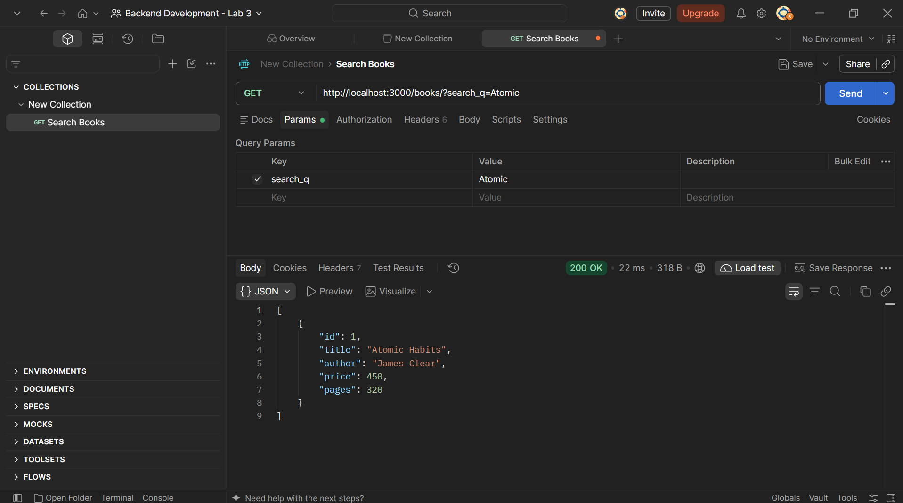

### 7.2 GET — Sort Books by Price

**Method:** GET  
**URL:** `http://localhost:3000/books/?order_by=price&order=DESC`  
**Result:** `200 OK`

The API returns books sorted by price in descending order.

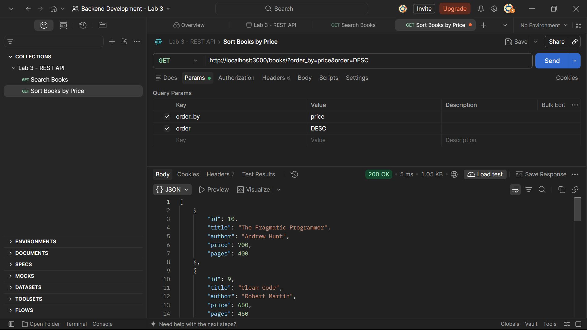

### 7.3 GET — Sorting Order Check

Sorting behavior was checked using the sort query parameters.

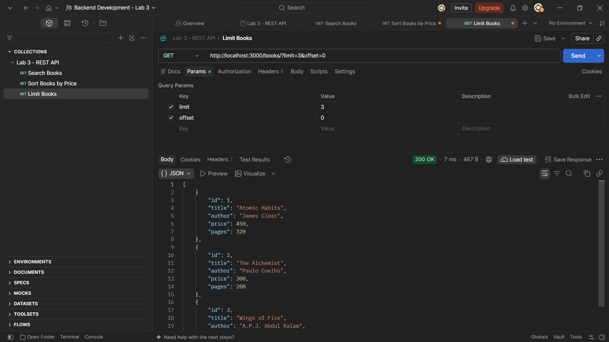

### 7.4 GET — Limit Books

**Method:** GET  
**URL:** `http://localhost:3000/books/?limit=3&offset=0`  
**Result:** `200 OK`

The limit parameter restricts the response to three book records.


### 7.5 GET — Limit and Offset

**Method:** GET  
**URL:** `http://localhost:3000/books/?limit=3&offset=3`  
**Result:** `200 OK`

The offset parameter skips the first three records and returns the next records.

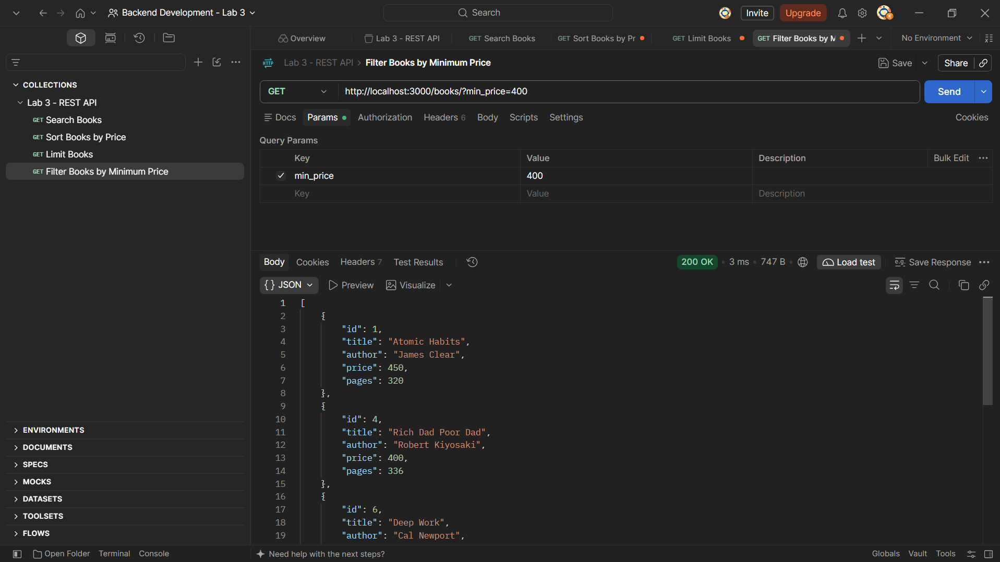

### 7.6 GET — Minimum Price Filter

**Method:** GET  
**URL:** `http://localhost:3000/books/?min_price=400`  
**Result:** `200 OK`

Returns books whose price is at least the specified minimum.

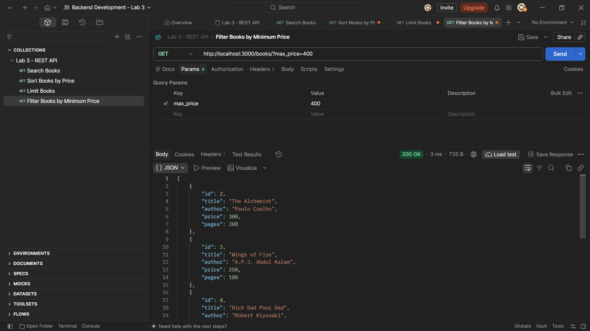

### 7.7 GET — Maximum Price Filter

**Method:** GET  
**URL:** `http://localhost:3000/books/?max_price=400`  
**Result:** `200 OK`

Returns books whose price is less than or equal to the specified maximum.


### 7.8 GET — Combined Price Filter

**Method:** GET  
**URL:** `http://localhost:3000/books/?min_price=300&max_price=500`  
**Result:** `200 OK`

Returns books within the selected price range.


### 7.9 POST — Missing Title Validation

**Method:** POST  
**URL:** `http://localhost:3000/books/`  
**Result:** `400 Bad Request`

The request omitted the title field. The API rejected the request and returned a validation message.

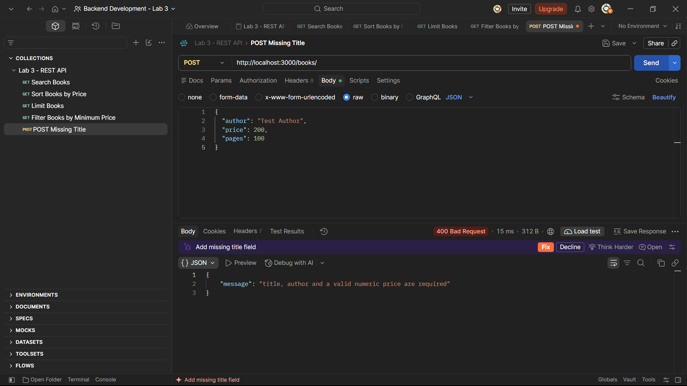

### 7.10 POST — Missing Author Validation

**Method:** POST  
**URL:** `http://localhost:3000/books/`  
**Result:** `400 Bad Request`

The request omitted the author field. The API returned a validation error.

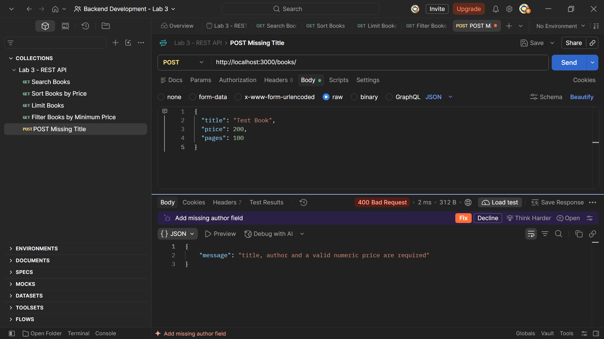

### 7.11 POST — Invalid Price Validation

**Method:** POST  
**URL:** `http://localhost:3000/books/`  
**Result:** `400 Bad Request`

A non-numeric price value was submitted. The API rejected the invalid input.

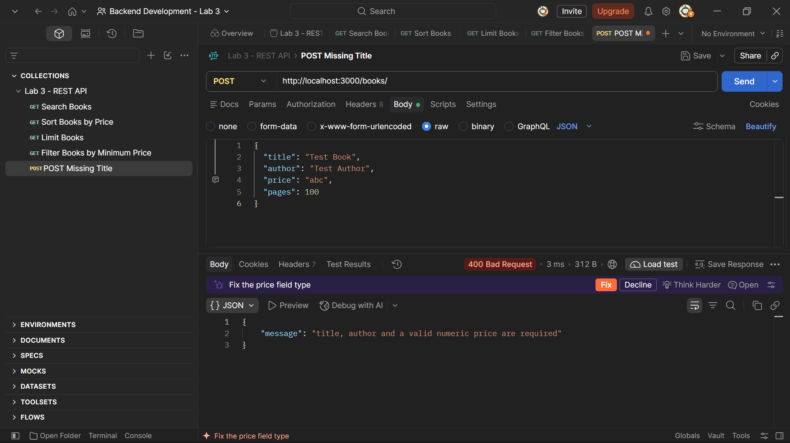

### 7.12 POST — Add a Book Successfully

**Method:** POST  
**URL:** `http://localhost:3000/books/`  
**Request Body:**

```json
{
  "title": "API Testing Book",
  "author": "Test Author",
  "price": 200,
  "pages": 100
}
```

**Result:** `201 Created`  
**Created Book ID:** `11`

The new book was added successfully to the database.

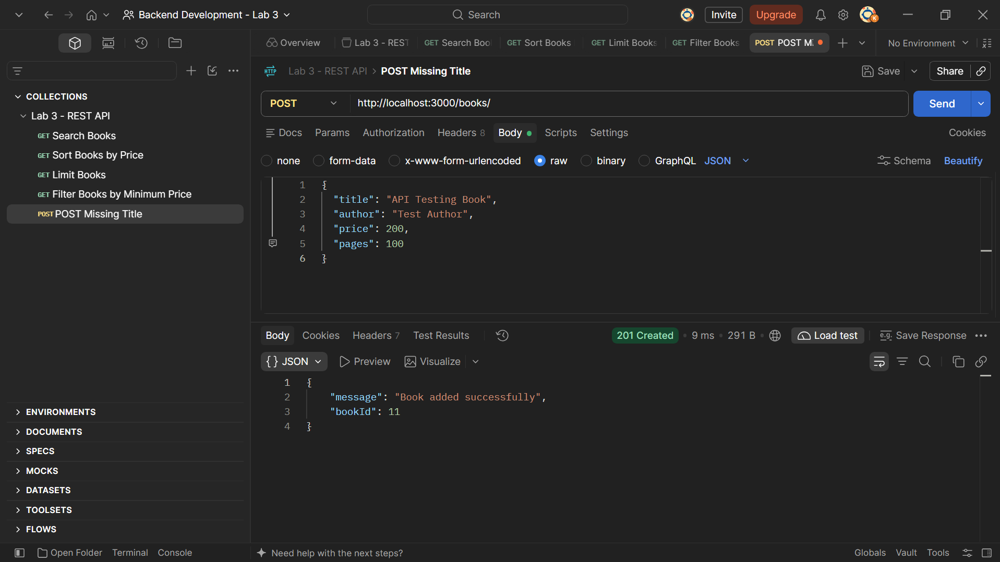

### 7.13 GET — Retrieve Book by ID

**Method:** GET  
**URL:** `http://localhost:3000/books/11`  
**Result:** `200 OK`

The API returned the details of the newly created book.

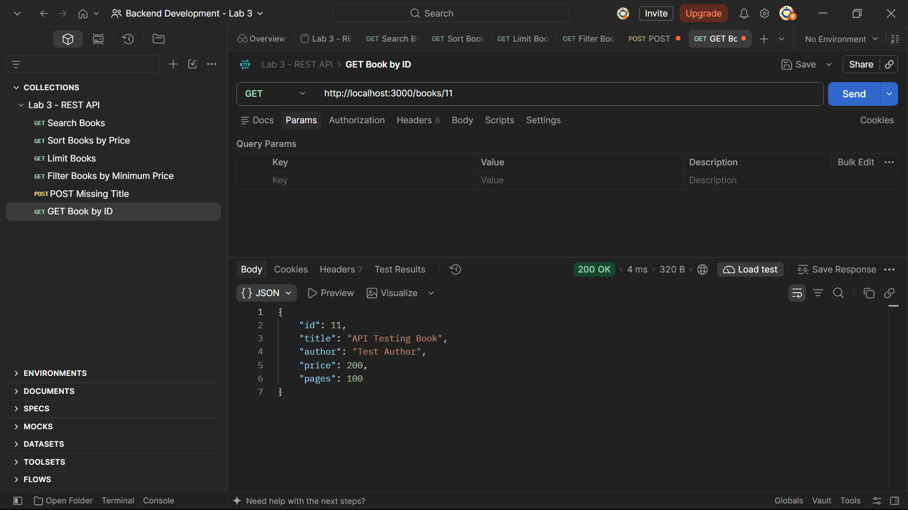

### 7.14 GET — Book Not Found

**Method:** GET  
**URL:** `http://localhost:3000/books/999`  
**Result:** `404 Not Found`

The API returned a not-found response because the requested book ID does not exist.

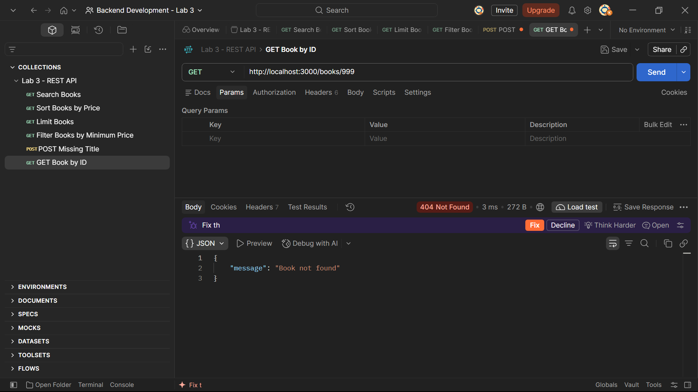

### 7.15 PUT — Update Book

**Method:** PUT  
**URL:** `http://localhost:3000/books/11`  
**Result:** `200 OK`

The existing book record was updated successfully.

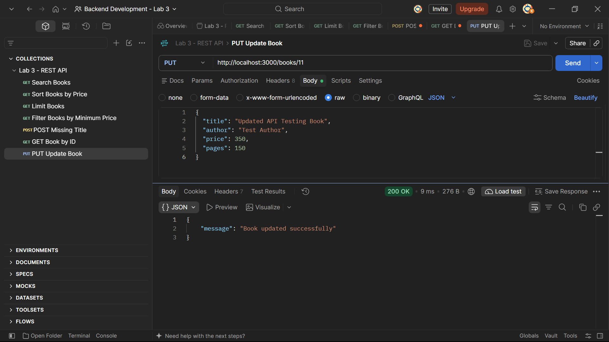

### 7.16 DELETE — Delete Book

**Method:** DELETE  
**URL:** `http://localhost:3000/books/11`  
**Result:** `200 OK`

The specified book record was deleted successfully.

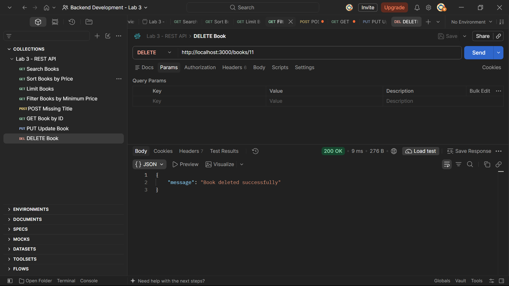

### 7.17 DELETE — Book Not Found

**Method:** DELETE  
**URL:** `http://localhost:3000/books/999`  
**Result:** `404 Not Found`

The API returned a not-found response when attempting to delete a non-existing book.

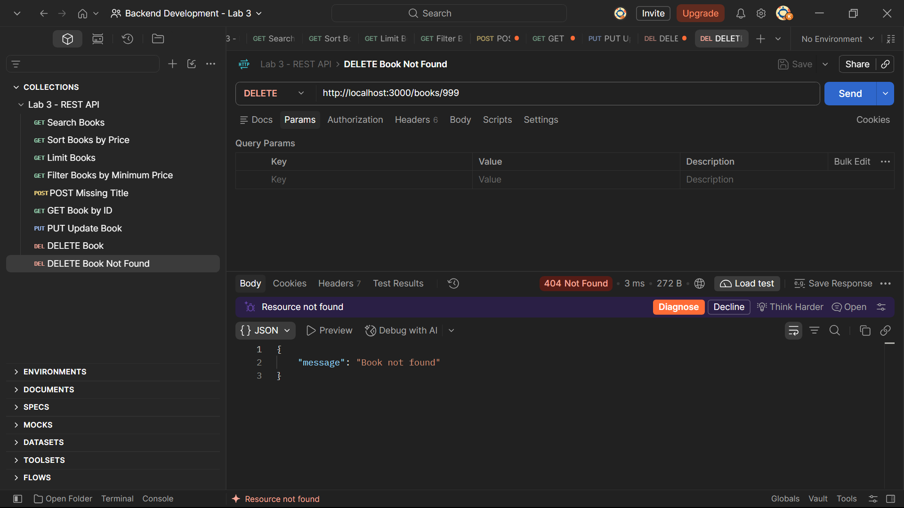

## 8. API Testing Summary

| Test Case | HTTP Method | Result |
|---|---|---|
| Search books | GET | 200 OK |
| Sort books by price | GET | 200 OK |
| Limit and offset | GET | 200 OK |
| Minimum price filter | GET | 200 OK |
| Maximum price filter | GET | 200 OK |
| Combined price filter | GET | 200 OK |
| Missing title | POST | 400 Bad Request |
| Missing author | POST | 400 Bad Request |
| Invalid price | POST | 400 Bad Request |
| Add a valid book | POST | 201 Created |
| Retrieve existing book | GET | 200 OK |
| Retrieve missing book | GET | 404 Not Found |
| Update existing book | PUT | 200 OK |
| Delete existing book | DELETE | 200 OK |
| Delete missing book | DELETE | 404 Not Found |

## 9. SQL Queries and Security

The application uses SQL operations for retrieving, adding, updating, and deleting records.

- `SELECT` — Retrieves records.
- `INSERT` — Adds records.
- `UPDATE` — Modifies records.
- `DELETE` — Removes records.
- `LIKE` — Supports partial title search.
- `ORDER BY` — Sorts records.
- `LIMIT` and `OFFSET` — Support pagination.
- Price conditions — Filter records using minimum and maximum prices.

Parameterized SQL queries using `?` placeholders help reduce SQL injection risk by separating input values from SQL instructions.

## 10. Problems Faced and Solutions

### Problem 1: Missing Required Fields

POST requests with missing title or author fields returned `400 Bad Request`.

**Solution:** The API validation checked the required fields and returned a JSON message when the request data was incomplete.

### Problem 2: Invalid Price Value

A POST request with a non-numeric price returned `400 Bad Request`.

**Solution:** The API validated the price input before inserting a record.

### Problem 3: Book ID Not Found

GET and DELETE requests with an unavailable ID returned `404 Not Found`.

**Solution:** The API checked whether the requested record existed and returned a not-found message when it did not.

## 11. Viva Questions

### Q1. What is the difference between a path parameter and a query parameter?

A path parameter identifies a specific resource, such as `/books/11`. A query parameter provides options for the request, such as `/books/?limit=3`.

### Q2. What is a stateless API?

A stateless API treats each request independently. Each request contains the information required by the server to process it.

### Q3. What is the difference between 400 and 404 status codes?

`400 Bad Request` indicates invalid request data. `404 Not Found` indicates that the requested resource does not exist.

### Q4. Why are query parameters used?

Query parameters allow searching, sorting, filtering, and pagination without creating separate endpoints for every condition.

### Q5. Why are parameterized SQL queries used?

Parameterized queries separate user input from SQL instructions and help protect against SQL injection.

## 12. Conclusion

In this lab, the REST API was enhanced with query parameters for searching, sorting, pagination, and price filtering. Input validation and error handling were tested using Postman. The API returned appropriate status codes for successful operations and invalid or missing records.

This lab provided practical experience with REST API design, query parameters, validation, SQLite operations, and API testing.

---

**Course:** Backend Development Fundamentals  
**Lab:** 03 — REST API Query Parameters, Validation, and Debugging  
**Submission:** GitHub Repository

## Live Deployment Link

**Live URL:** To be added after deployment.
