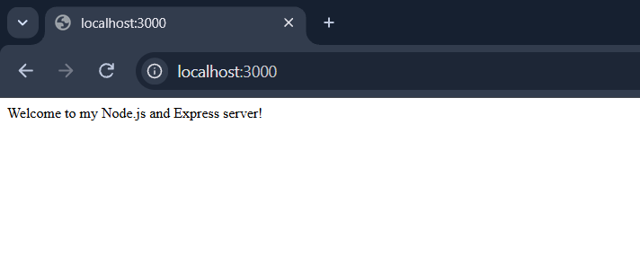
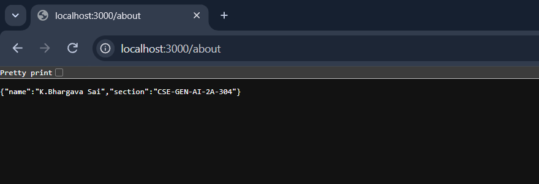
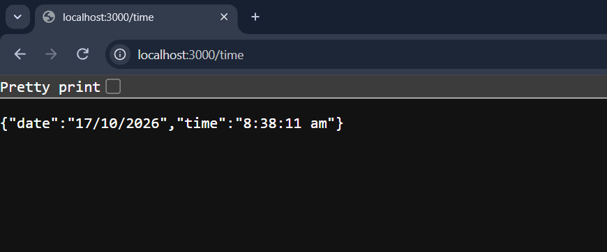
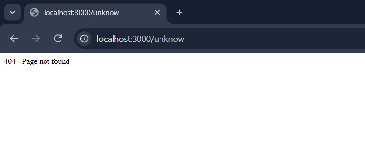

# Lab 1: Node.js and Express Server

Subject: Backend Development Fundamentals  
Year/Term: Year II, Term II  
University: Aurora Deemed to be University  
Faculty: Mr. Joel Prashanth D

## Student Details

| Field | Details |
|---|---|
| Name | K.Bhargava Sai |
| Registration Number | 252U1R9055 |
| Section | CSE - GEN-AI - 2A-304 |

## Live Deployment

Deployment Link: Not deployed yet.

## Project Objective

This lab demonstrates how to create a basic server using Node.js and Express.js. It includes project setup, installing Express, creating routes, returning JSON responses, displaying the current date and time, and handling unknown routes.

## Technologies Used

- Node.js
- Express.js
- npm (Node Package Manager)
- JavaScript (CommonJS)
- HTTP and JSON response handling
- Render (Deployment Platform)
- GitHub (Version Control and Repository Hosting)

## Project Folder Structure

```text
lab-01/
├── app.js
├── server.js
├── package.json
├── package-lock.json
├── README.md
├── .gitignore
└── screenshots/
    ├── home.png
    ├── about.png
    ├── time.png
    └── unknown.png
```

## Installation and Execution

### Prerequisites

- Node.js and npm installed on the computer.
- Visual Studio Code or another code editor.
- Git, if using Git for version control.

### 1. Initialize the Project

Run this command in the project directory:

```bash
npm init -y
```

### 2. Install Express.js

```bash
npm install express
```

### 3. Run the Basic Node.js HTTP Server

```bash
node server.js
```

Open this URL in the browser:

`http://localhost:3000`

The server responds with `Hello`.

Stop the server using `Ctrl + C` before starting the Express server.

### 4. Run the Express Server

```bash
node app.js
```

Open `http://localhost:3000` in the browser to test the routes.

## Endpoints

| HTTP Method | Path | Description | Expected Status Code |
|---|---|---|---|
| GET | `/` | Returns a welcome message | 200 |
| GET | `/about` | Returns my name and section in JSON format | 200 |
| GET | `/time` | Returns the current date and time | 200 |
| Any | Any unknown path | Returns a Page Not Found message | 404 |

### Live Endpoint URLs

- Home: Not deployed yet.
- About: Not deployed yet.
- Time: Not deployed yet.
- 404 Test: Not deployed yet.

## Screenshots

Screenshots of the working application are stored in the `screenshots/` directory.

### 1. Home Route



### 2. About Route



### 3. Time Route



### 4. Unknown Route — 404 Not Found



## Problems Faced and Solutions

| Problem | Solution |
|---|---|
| Initializing the Node.js project | Used `npm init -y` to create `package.json`. |
| Installing Express | Used `npm install express`. |
| Testing the routes | Opened each route in the browser. |
| Handling unknown routes | Added a route handler that returns status code 404. |
| Running multiple servers on the same port | Stopped the running server before starting another server on port 3000. |

## Learning Outcomes

- Created a Node.js project using npm.
- Installed Express.js and used it to create a server.
- Created GET routes using `app.get()`.
- Returned text and JSON responses.
- Displayed the current date and time using `new Date()`.
- Handled unknown routes using status code 404.
- Tested the endpoints in a browser.
- Prepared screenshots and project documentation for GitHub submission.

## Git Hygiene

The following entries should be included in the `.gitignore` file:

```text
node_modules/
.env
```

Do not upload the `node_modules/` directory or `.env` file to GitHub.
