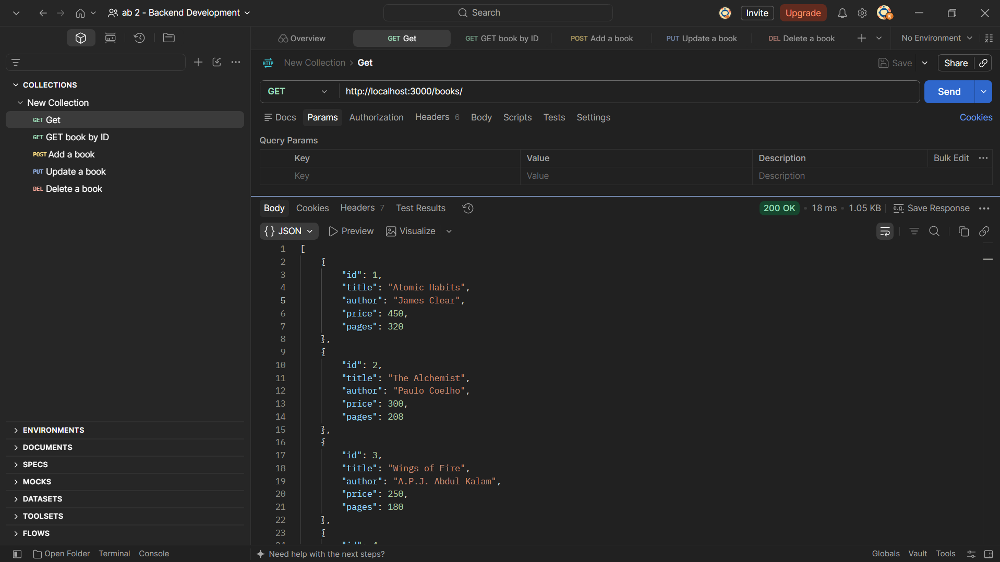
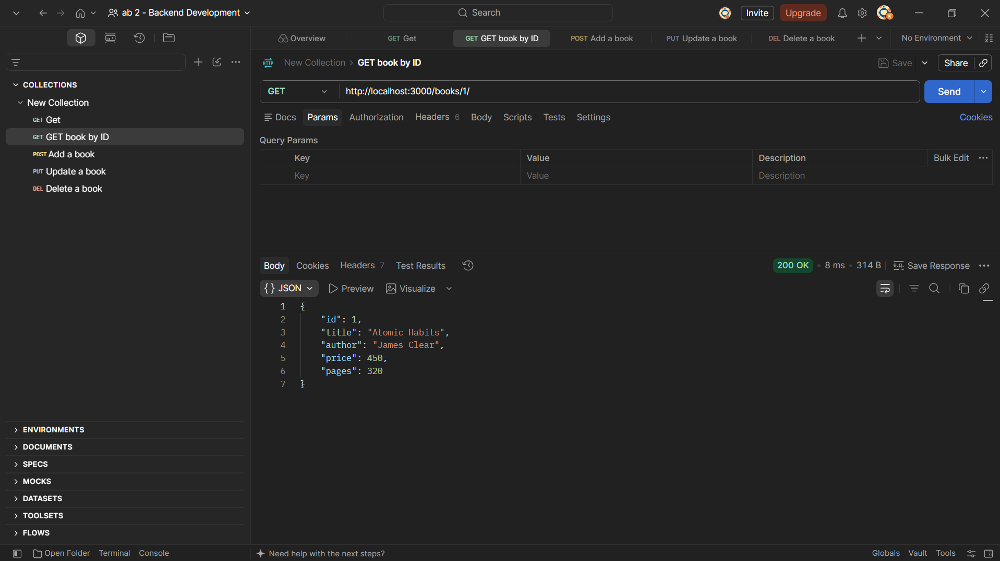
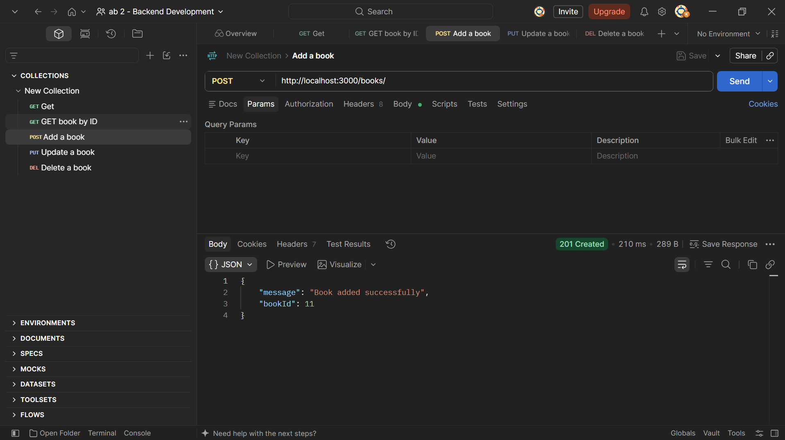
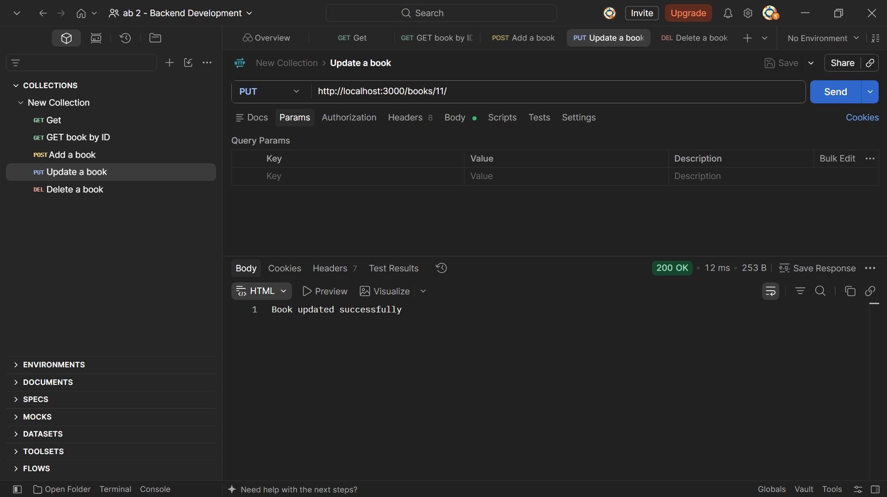

# Lab 2: SQLite Database and CRUD Routes

Subject: Backend Development Fundamentals  
Year/Term: Year II, Term II  
University: Aurora Deemed to be University  
Faculty: Mr. Joel Prashanth D

## Student Details

| Field | Details |
|---|---|
| Name | K.Bhargava Sai |
| Registration Number | 252U1R9055 |
| Section | CSE - GEN-AI - 2A-304 |


## Live Demo

**Live URL:** https://lab-02-sqlite-api.onrender.com

**Local Server:** `http://localhost:3000`

**GitHub Repository:** [Backend Development Fundamentals](https://github.com/kbhargavasai2468-cyber/Backend-Development-Fundamentals)

**Note:** The application currently runs on localhost. A public deployment URL has not been created yet. All five CRUD endpoints were tested successfully using the Postman Desktop Application, and screenshots are provided below.

---

## 1. Objective

To connect an Express.js server to a SQLite database and implement CRUD (Create, Read, Update, Delete) operations using REST API endpoints.

The application allows users to retrieve, add, update, and delete book records stored in a SQLite database.

## 2. Technologies Used

- Node.js — JavaScript runtime environment
- Express.js — Backend web framework
- SQLite — Relational database
- sqlite3 — SQLite database driver
- sqlite — Promise-based SQLite interface
- Nodemon — Automatically restarts the server during development
- Postman Desktop App — API testing
- Visual Studio Code — Code editor
- Git and GitHub — Version control and submission

## 3. Project Structure

```text
lab-02/
├── screenshots/
│   ├── get-all-books.png
│   ├── get-book-by-id.png
│   ├── post-add-book.png
│   ├── put-update-book.png
│   └── delete-book.png
├── .gitignore
├── app.js
├── books.db
├── package.json
├── package-lock.json
└── README.md
```

## 4. Installation and Setup

### Step 1: Clone the Repository

```bash
git clone https://github.com/kbhargavasai2468-cyber/Backend-Development-Fundamentals.git
```

### Step 2: Navigate to the Lab Folder

```bash
cd Backend-Development-Fundamentals/lab-02
```

### Step 3: Install Dependencies

```bash
npm install
```

The project uses Express.js, SQLite, and related dependencies.

### Step 4: Start the Server

```bash
npm start
```

Expected terminal output:

```text
Server running at http://localhost:3000
```

### Step 5: Test the API

Open Postman Desktop App and send requests to:

```text
http://localhost:3000
```

**Environment Variables:** No environment variables are currently required for local execution.

## 5. Database Description

**Database:** `books.db`

**Table:** `book`

| Column | Data Type | Description |
|---|---|---|
| id | INTEGER | Primary key identifying each book |
| title | TEXT | Name of the book |
| author | TEXT | Author of the book |
| price | INTEGER | Price of the book |
| pages | INTEGER | Number of pages |

The SQLite database stores book information and supports SQL operations such as SELECT, INSERT, UPDATE, and DELETE.

## 6. API Endpoints

| HTTP Method | Endpoint | Description |
|---|---|---|
| GET | `/books/` | Retrieve all books |
| GET | `/books/:bookId/` | Retrieve a book using its ID |
| POST | `/books/` | Add a new book |
| PUT | `/books/:bookId/` | Update an existing book |
| DELETE | `/books/:bookId/` | Delete a book using its ID |

## 7. CRUD Operations and Results

### 7.1 GET — Retrieve All Books

**Method:** GET

**URL:**

```text
http://localhost:3000/books/
```

**Status:** `200 OK`

**Description:** Retrieves all book records from the SQLite database and returns them as a JSON array.

**Postman Output:**



### 7.2 GET — Retrieve Book by ID

**Method:** GET

**URL:**

```text
http://localhost:3000/books/1/
```

**Status:** `200 OK`

**Description:** Retrieves details of a particular book using its ID.

**Example Response:**

```json
{
  "id": 1,
  "title": "Atomic Habits",
  "author": "James Clear",
  "price": 450,
  "pages": 320
}
```

**Postman Output:**



### 7.3 POST — Add a New Book

**Method:** POST

**URL:**

```text
http://localhost:3000/books/
```

**Request Body:**

```json
{
  "title": "Deep Work",
  "author": "Cal Newport",
  "price": 400,
  "pages": 300
}
```

**Status:** `201 Created`

**Response:**

```json
{
  "message": "Book added successfully",
  "bookId": 11
}
```

**Description:** Inserts a new book record into the SQLite database.

**Postman Output:**



### 7.4 PUT — Update an Existing Book

**Method:** PUT

**URL:**

```text
http://localhost:3000/books/11/
```

**Request Body:**

```json
{
  "title": "Deep Work - Updated",
  "author": "Cal Newport",
  "price": 450,
  "pages": 320
}
```

**Status:** `200 OK`

**Response:**

```text
Book updated successfully
```

**Description:** Updates the existing book record using its ID.

**Postman Output:**



### 7.5 DELETE — Delete a Book

**Method:** DELETE

**URL:**

```text
http://localhost:3000/books/11/
```

**Status:** `200 OK`

**Response:**

```text
Book deleted successfully
```

**Description:** Removes the specified book record from the SQLite database.

**Postman Output:**


## 8. API Testing Summary

All five API endpoints were tested using the Postman Desktop Application.

| Operation | HTTP Method | Result |
|---|---|---|
| Retrieve all books | GET | 200 OK |
| Retrieve book by ID | GET | 200 OK |
| Add a new book | POST | 201 Created |
| Update a book | PUT | 200 OK |
| Delete a book | DELETE | 200 OK |

**Result:** All five CRUD API requests executed successfully.

## 9. SQL Queries and Security

The application uses SQLite queries for database operations.

- SELECT — Retrieves records.
- INSERT — Adds records.
- UPDATE — Modifies existing records.
- DELETE — Removes records.

Parameterized SQL queries using `?` placeholders help protect against SQL injection when handling user-supplied values.

## 10. Problems Faced and Solutions

### Problem 1: Postman Desktop Agent Crash

The Postman Desktop Agent was crashing on Windows, preventing local API testing through the Postman web interface.

**Solution:** Used the Full Postman Desktop Application to test the API endpoints directly.

### Problem 2: Postman Desktop Application Not Opening

The desktop application initially failed to launch.

**Solution:** Launched the application using the following PowerShell command:

```powershell
& "$env:LOCALAPPDATA\Postman\Postman.exe" --disable-gpu --disable-gpu-sandbox
```

The application opened successfully, allowing API testing to continue.

### Problem 3: Incorrect API Endpoint

Sending a GET request to the root URL returned `404 Not Found`.

**Solution:** Used the correct endpoint:

```text
http://localhost:3000/books/
```

The server returned the expected book data.

## 11. Viva Questions

### Q1. Why do we use `await` for database calls?

`await` waits for an asynchronous database operation to complete before continuing execution. This helps ensure that the application receives the database result before using it.

### Q2. What is SQL Injection?

SQL injection is a security vulnerability in which malicious input changes the intended behavior of an SQL query.

Parameterized queries using `?` placeholders separate user input from SQL instructions, reducing the risk of SQL injection.

### Q3. What is the difference between POST and PUT?

**POST:** Used to create a new resource.

**PUT:** Used to replace or update a resource at a specified URL.

## 12. Conclusion

In this lab, an Express.js backend was connected to a SQLite database to perform CRUD operations on book records.

Five REST API endpoints were implemented and successfully tested using the Postman Desktop Application.

The lab demonstrates backend routing, asynchronous database operations, SQLite queries, HTTP methods, and API testing.

---

**Course:** Backend Development Fundamentals

**Lab:** 02 — SQLite Database and CRUD Routes

**Submission:** GitHub Repository
